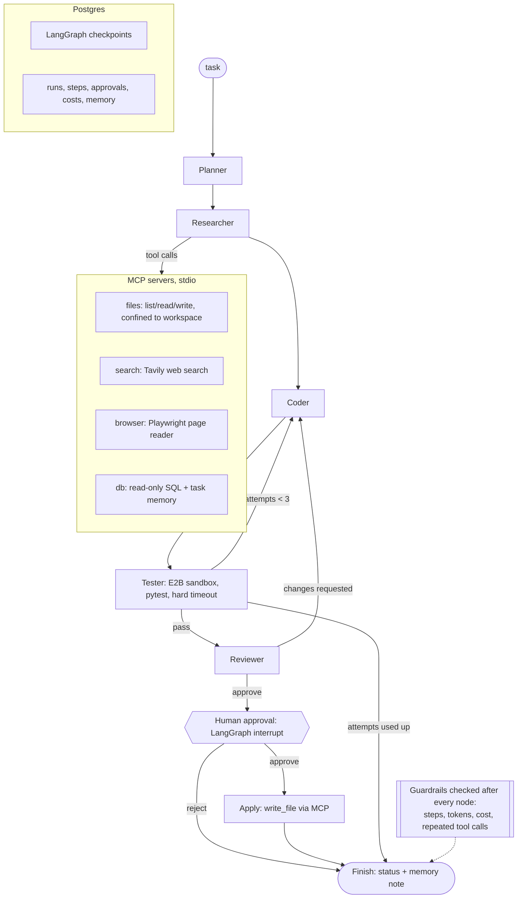

# Multi-Agent Autonomous Workflow System

A team of AI agents (planner, researcher, coder, reviewer) that fixes bugs in Python programs. The agents use
tools through MCP servers, run every candidate fix inside an E2B cloud sandbox, and ask a human before writing
anything to the repository. Run history, memory and checkpoints are stored in Postgres; every step is traced with
OpenTelemetry. Evaluated on 20 tasks from the QuixBugs benchmark.

Built for the Nexvia Technologies GenAI internship, project GENAI-02.

## Architecture



| Requirement | Implementation |
|---|---|
| Agents + shared state graph | LangGraph `StateGraph` with typed shared state ([`agent/graph.py`](agent/graph.py)) |
| MCP tools | 4 FastMCP servers in [`mcp_servers/`](mcp_servers): files, web search (Tavily), DB queries, browser (Playwright). The graph talks to them through `langchain-mcp-adapters` with persistent stdio sessions ([`agent/mcp_hub.py`](agent/mcp_hub.py)) |
| Safe code execution | Every candidate runs in a fresh E2B sandbox under `timeout` ([`agent/sandbox.py`](agent/sandbox.py)); nothing generated runs on the host |
| Human approval | LangGraph `interrupt()` before the file write; resume with approve/reject from the web UI or CLI |
| Memory + history | Postgres: LangGraph `PostgresSaver` checkpoints + `runs`, `steps`, `approvals`, `costs`, `memory` tables ([`agent/db.py`](agent/db.py)). The researcher can read notes from earlier runs of the same task |
| Tracing | OpenTelemetry spans for each run, node, MCP tool call and sandbox run; written to `traces/spans.jsonl` and optionally exported over OTLP (Jaeger) |
| Guardrails | Step cap 25, token cap 200k, cost cap $0.10 per run, loop detection (same tool + same args 3 times), sandbox timeout 60 s, max 3 fix attempts |

**Benchmark-leak protection.** QuixBugs fixes are public, so the search and browser servers block GitHub/GitLab
and the QuixBugs site and drop any result that mentions "QuixBugs".

## Results

20 QuixBugs tasks, model `openai/gpt-4.1-mini`, 4 runs in parallel. A task counts as solved only if the fix
passed in the sandbox, the reviewer and approver accepted it, and the written repo file passed again in a fresh
sandbox. Full table: [`eval/results/REPORT.md`](eval/results/REPORT.md).

| Version | Solved | Avg steps | Avg cost / task | Total cost | Avg time / task | Approvals requested | Guardrail stops |
|---|---|---|---|---|---|---|---|
| v1 baseline | 14 / 20 (70%) | 8.1 | $0.0032 | $0.063 | 25.9 s | 14 | 1 |
| v2 (current) | **19 / 20 (95%)** | 8.6 | $0.0040 | $0.079 | 28.7 s | 19 | 0 |

What changed from v1 to v2 (from reading the stored run steps in Postgres):

- In v1 the coder never saw its own failed patch. In the 5 failed runs it made 3 attempts each but produced only 1
  or 2 distinct patches (3 runs submitted the identical wrong patch three times). v2 shows it the failed diff plus
  test output, tells it not to repeat the change, and asks it to trace an example before patching.
- In v1, `list_files` returned paths with the run-ID prefix. The researcher reused them, the read failed, it retried
  the same call, and loop detection stopped the run (`possible_change`). v2 strips the prefix. The guardrail did
  its job; the cause was a tool bug.

The one v2 failure (`max_sublist_sum`) still repeated one patch for all 3 attempts
(`scripts/repeat_check.py`), so the repeat problem is reduced, not solved.

Guardrail and approval checks on real runs (outputs in `eval/results/`):

- `MAX_STEPS=5` on `max_sublist_sum`: the run stopped with `guardrail: step cap (5)` (`guardrail_demo.txt`).
- Rejecting the approval for `gcd` ended the run as `rejected`, and the repo file stayed byte-identical to the
  original (`rejection_demo.txt`).
- Unit tests cover the step, token and cost caps, loop detection, routing, and the workspace path check.

## Run it

Requires Python 3.12 with [uv](https://docs.astral.sh/uv/). No Docker needed: if `DATABASE_URL` is empty, an
embedded Postgres 16 (`pgserver`) starts under `./.pgdata`.

```bash
git clone --depth 1 https://github.com/jkoppel/QuixBugs ../QuixBugs   # set QUIXBUGS_DIR if elsewhere
cp .env.example .env          # add LLM_API_KEY, E2B_API_KEY, TAVILY_API_KEY
uv sync
uv run playwright install chromium
uv run python scripts/smoke_check.py           # checks E2B, Postgres, Playwright

uv run python -m agent.cli gcd                 # one task; you approve the diff in the terminal
uv run uvicorn ui.app:app --port 8100          # web UI: start runs, watch steps, approve/reject
uv run python eval/run_eval.py                 # all 20 tasks (~5 min with 4 workers)
uv run python scripts/show_run.py gcd          # print the stored steps of the latest gcd run
uv run pytest
```

To send traces to Jaeger: `docker run -p 16686:16686 -p 4318:4318 jaegertracing/all-in-one` and set
`OTEL_EXPORTER_OTLP_ENDPOINT=http://localhost:4318` (not tested here; Docker was not available).

## Project layout

```
agent/        config, graph (agents + routing + guardrails), runner, mcp_hub, sandbox, db, telemetry, tasks, cli
mcp_servers/  files, search, browser, db MCP servers
ui/           FastAPI + single-page HTML UI
eval/         run_eval.py, results/ (current), results_v1_baseline/ (first version)
scripts/      smoke_check, show_run
tests/        guardrails, routing, task files, workspace path safety
```

## Limitations

- During evaluation the approval interrupt fires on every run but is answered by an automatic approver, so the
  numbers measure the agents, not human review time. The approval flow itself was tested by hand in the UI.
- QuixBugs bugs are one-line bugs in small programs; this is far easier than real repositories (e.g. SWE-bench).
- Costs use list prices for `openai/gpt-4.1-mini` on OpenRouter.
